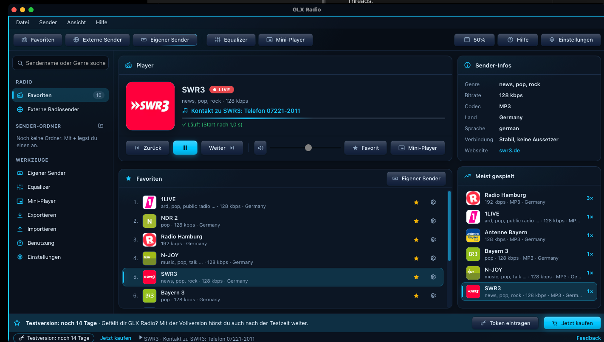
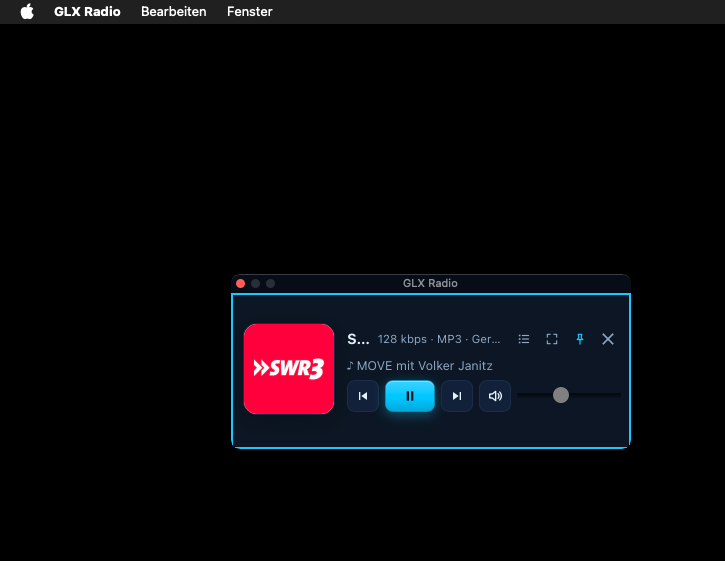
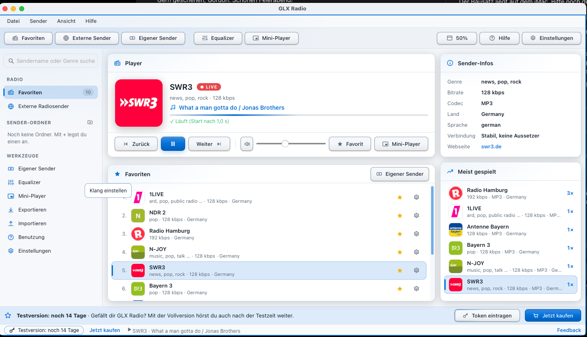
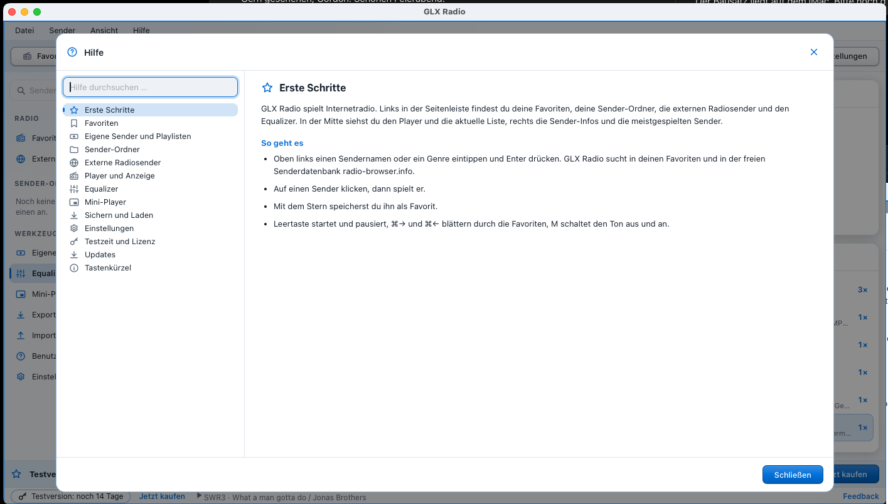
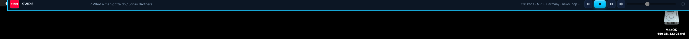

🌍 Sprachen: [🇺🇸 English](README.md) | [🇩🇪 Deutsch](README.de.md)

# 💠 GLX Radio macOS

### Internetradio ohne Browser, für deinen Mac.

*Deine Lieblingssender direkt auf dem Mac, dazu Tausende weitere aus radio-browser.info.* ⚡

   

---

## ⬇️ Download

👉 Neueste Version: [Releases](../../releases/latest)  
👉 Shop und Lizenzen: [glx-tools.de](https://glx-tools.de/product/glx-radio-macos/)

---

## 📖 Über GLX Radio macOS

### Dein Radio für jeden Tag

GLX Radio macOS ist das Internetradio für alle, die beim Arbeiten, Kochen oder Entspannen ihre Lieblingssender hören wollen, ohne Browser-Tab und ohne Werbung im Programm. Das große Fenster ist übersichtlich in Kästen aufgeteilt: Player, Senderliste, Sender-Infos und deine meistgespielten Sender auf einen Blick.

### Tausende Sender finden

Tipp einfach einen Sendernamen oder ein Genre ein, zum Beispiel Rock, Jazz, Schlager oder Nachrichten. GLX Radio sucht in deinen Favoriten und in der freien Senderdatenbank radio-browser.info mit Sendern aus aller Welt. Unter "Externe Radiosender" findest du die beliebtesten deutschen Sender, mit "Mehr laden" kommen weitere dazu.

### Favoriten und Sender-Ordner

Mit einem Klick auf den Stern landet ein Sender in deinen Favoriten. Die Reihenfolge bestimmst du selbst, Vor und Zurück im Player blättern genau so durch deine Liste. Mit eigenen Ordnern sortierst du deine Sender zum Beispiel nach Musikrichtung, Region oder Stimmung.

### Eigene Sender und Playlisten

Du brauchst keine Datenbank: Jeden Sender trägst du auch selbst mit seinem Stream-Link ein. Erlaubt sind direkte Ströme wie MP3 oder AAC und Wiedergabelisten wie M3U, M3U8, PLS, ASX oder XSPF, die GLX Radio selbst auflöst. Als Logo nimmst du einen Bild-Link, ein Bild vom Mac oder eins aus deinem eigenen Logo-Ordner.

### Player mit Titelanzeige

Der Player zeigt Logo, Sender und den gerade laufenden Titel, sofern der Sender ihn mitschickt. Bricht der Strom einmal ab, verbindet sich GLX Radio von selbst neu. Die Sender-Infos zeigen Genre, Bitrate, Codec, Land, Sprache und den Zustand der Verbindung, "Meist gespielt" zeigt deine häufigsten Sender.

### Equalizer

Der Equalizer hat 10 Bänder, eine Vorverstärkung und fertige Vorgaben wie Rock, Pop, Jazz, Klassik, Dance, Bass-Anhebung, Sprache oder Nachtmodus. Deine eigenen Einstellungen speicherst du als eigene Vorgabe.

### Mini-Player

Der Mini-Player ist ein kleines Fenster, das auf Wunsch über allen anderen Fenstern liegt. Damit steuerst du Abspielen, Lautstärke und Senderwechsel, ohne das große Fenster offen zu haben. Deine Favoriten klappst du darin mit einem Klick auf.

### Sichern und Umziehen

Alle Favoriten mit Ordnern sicherst du in eine Datei und lädst sie auf einem anderen Mac wieder. Auch die Sicherungsdatei aus der Nextcloud-App GLX Radio lässt sich übernehmen. Deine Daten bleiben auf deinem Mac, ein Konto brauchst du nicht.

### Bedienung

12 Designs, Deutsch und Englisch, eine eingebaute Hilfe und Tastenkürzel wie Leertaste für Abspielen und Pause. Die Wiedergabeanzeige von macOS und die Mediatasten zeigen Sender und Titel.

### Testen und Freischalten

Du kannst GLX Radio 14 Tage lang mit allen Funktionen kostenlos testen. Danach bleiben deine Favoriten, Ordner und Einstellungen erhalten, nur zum Abspielen brauchst du die Vollversion. Nach dem Kauf bekommst du einen GLX-Token per E-Mail, den du in den Einstellungen einträgst.

---

## 📸 Überblick & Screenshots

### 1️⃣ Hauptfenster

### 2️⃣ Ansicht 2

### 3️⃣ Ansicht 3

### 4️⃣ Ansicht 4

### 5️⃣ Ansicht 5

---

## ✨ Funktionen

- 🚀 **Echter Mac-Player:** Radio direkt in einer eigenen App, ohne Browser-Tab und ohne Nextcloud.
- 🧩 **Sofort startklar:** Zehn geprüfte deutsche Sender sind beim ersten Start schon als Favoriten eingerichtet.
- ⚙️ **Tausende Sender:** Suche nach Sendername oder Genre in der freien Datenbank radio-browser.info.
- 🔒 **Drei Player-Größen:** Großer Player, kompakter Mini-Player und ein schmaler Leisten-Player, der oben am Bildschirm andockt.
- 📂 **Empfangsdaten live:** Bitrate, Codec, Land und Genre werden beim Hören angezeigt.
- ⚡ **Ladering:** Ein Ring um das Senderlogo zeigt, dass ein Sender gerade verbindet.
- 🎨 **Favoriten:** Deine eigene Senderliste für den schnellen Zugriff.
- 🌍 **12 Designs:** Mit passenden Fensterrahmen.
- 🛠️ **Zwei Sprachen:** Deutsch und Englisch mit eingebauter Hilfe.
- 📊 **14 Tage testen:** Alle Funktionen 14 Tage kostenlos, danach Freischaltung mit einem Lizenz-Token.

---

## 🧩 Systemanforderungen

- macOS (Intel oder Apple Silicon)

---

## 🧪 Testzeitraum & Lizenz

Alle Funktionen 14 Tage kostenlos, danach Lizenz-Token von [glx-tools.de](https://glx-tools.de).

---

## 🔗 Mehr zu diesem Produkt

👉 [glx-tools.de](https://glx-tools.de/product/glx-radio-macos/)  
Support: **info@glx-tools.de**

---

## 📄 Lizenz

Copyright © 2026 GLX Tools – Gordon Lehmann. Alle Rechte vorbehalten.  
Dies ist proprietäre kommerzielle Software. Es wird keine Open-Source-Lizenz gewährt. Dieses Repository enthält nur Release-Downloads und Dokumentation; der Quelltext wird nicht veröffentlicht.

---

Mit ❤️ gemacht von **Dreamdancer100**

