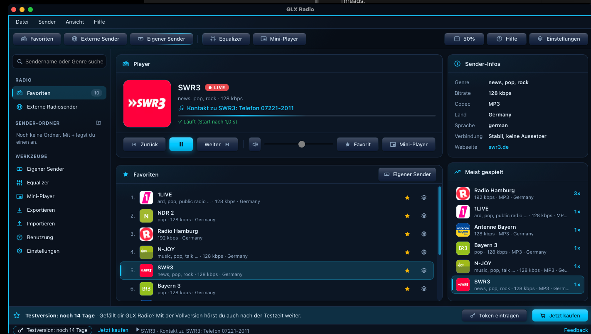
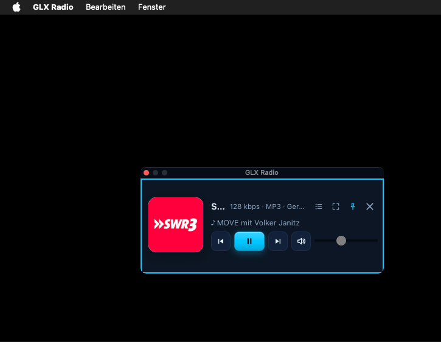
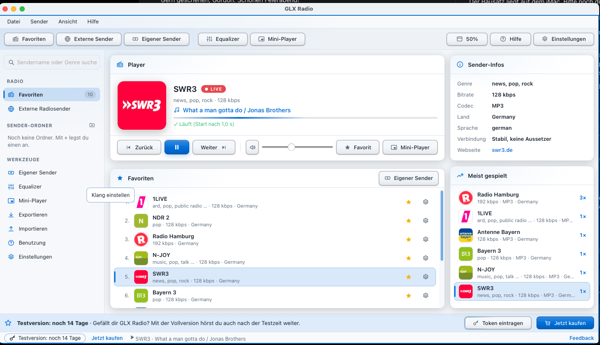
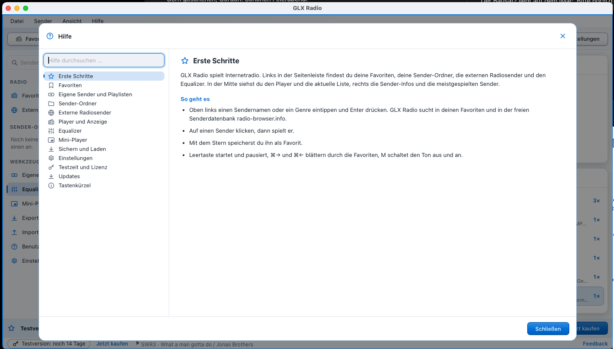
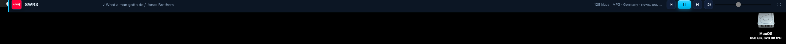

🌍 Languages: [🇺🇸 English](README.md) | [🇩🇪 Deutsch](README.de.md)

# 💠 GLX Radio macOS

### Internet radio without a browser, for your Mac.

*Your favourite stations in their own Mac app, with thousands more from radio-browser.info.* ⚡

   

---

## ⬇️ Download

👉 Latest version: [Releases](../../releases/latest)  
👉 Shop and licences: [glx-tools.de](https://glx-tools.de/product/glx-radio-macos/)

---

## 📖 About GLX Radio macOS

### Your radio for every day

GLX Radio macOS is the internet radio for everyone who wants to listen to their favourite stations while working, cooking or relaxing, without a browser tab and without ads in the program. The large window is clearly divided into panels: player, station list, station info and your most played stations at a glance.

### Find thousands of stations

Just type a station name or a genre, for example rock, jazz, schlager or news. GLX Radio searches your favourites and the free station database radio-browser.info with stations from all over the world. Under "External radio stations" you find the most popular German stations, and "Load more" adds further ones.

### Favourites and station folders

One click on the star adds a station to your favourites. You decide the order, and Previous and Next in the player follow exactly your list. With your own folders you sort stations by genre, region or mood.

### Your own stations and playlists

You don't need a database: you can add any station yourself with its stream link. Direct streams such as MP3 or AAC and playlists such as M3U, M3U8, PLS, ASX or XSPF are supported, GLX Radio resolves them itself. As a logo you use an image link, a picture from your Mac or one from your own logo folder.

### Player with title display

The player shows logo, station and the current title, if the station sends it. If the stream drops, GLX Radio reconnects by itself. Station info shows genre, bitrate, codec, country, language and connection state, and "Most played" shows your favourite stations.

### Equalizer

The equalizer has 10 bands, a preamp and ready presets such as Rock, Pop, Jazz, Classical, Dance, Bass Boost, Speech or Night mode. Save your own settings as a custom preset.

### Mini player

The mini player is a small window that can stay on top of all other windows. Control playback, volume and station changes without the large window open. Your favourites unfold in it with one click.

### Back up and move

Back up all favourites with folders into one file and load it again on another Mac. The backup file from the Nextcloud app GLX Radio can be imported too. Your data stays on your Mac, no account needed.

### Operation

12 designs, German and English, built-in help and keyboard shortcuts such as Space for play and pause. The macOS Now Playing display and the media keys show station and title.

### Try and unlock

You can test GLX Radio for 14 days with all features free of charge. After that your favourites, folders and settings remain, you only need the full version for playback. After purchase you receive a GLX token by email, which you enter in the settings.

---

## 📸 Overview & Screenshots

### 1️⃣ Main window

### 2️⃣ View 2

### 3️⃣ View 3

### 4️⃣ View 4

### 5️⃣ View 5

---

## ✨ Features

- 🚀 **Native Mac player:** Radio directly in its own app, no browser tab, no Nextcloud.
- 🧩 **Ready to play:** Ten verified German stations are set up as favourites on the first start.
- ⚙️ **Thousands of stations:** Search by name or genre in the public radio-browser.info database.
- 🔒 **Three player sizes:** Full player, compact mini player and a slim bar player docked at the top of the screen.
- 📂 **Live reception data:** Bitrate, codec, country and genre are shown while playing.
- ⚡ **Loading ring:** A ring around the station logo shows when a station is connecting.
- 🎨 **Favourites:** Keep your own station list for quick access.
- 🌍 **12 designs:** With matching window borders.
- 🛠️ **Two languages:** German and English with built-in help.
- 📊 **14-day trial:** All features free for 14 days, then unlocked with a licence token.

---

## 🧩 Requirements

- macOS (Intel or Apple silicon)

---

## 🧪 Trial & License

All features free for 14 days, then a licence token from [glx-tools.de](https://glx-tools.de).

---

## 🔗 More about this product

👉 [glx-tools.de](https://glx-tools.de/product/glx-radio-macos/)  
For support: **info@glx-tools.de**

---

## 📄 License

Copyright © 2026 GLX Tools – Gordon Lehmann. All rights reserved.  
This is proprietary commercial software. No open-source license is granted. This repository contains release downloads and documentation only; the source code is not published.

---

Made with ❤️ by **Dreamdancer100**

